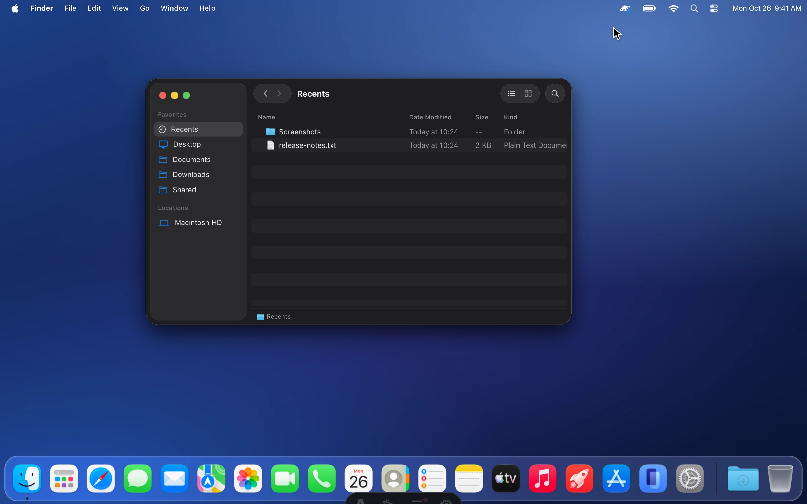

<p align="center">
  <picture>
    <source srcset="assets/logo-dark.svg" media="(prefers-color-scheme: dark)">
    <source srcset="assets/logo-light.svg" media="(prefers-color-scheme: light)">
    
  </picture>
</p>
<h3 align="center">hypervised desktop<br>for autonomous agents</h3>
<p align="center">Atlas gives your agent a hidden second desktop on your Mac.<br>It clicks, types and tests apps there while you keep working on yours.</p>
<p align="center">
  <a href="https://github.com/InsaneArts/atlas/actions/workflows/ci.yml"></a>
  <a href="https://github.com/InsaneArts/atlas/releases"></a>
  
  <a href="Cargo.toml"></a>
</p>

[](https://atlas.insanearts.io)

## Install

Requires macOS 14 or later and an administrator account for setup:

```sh
curl -fsSL https://atlas.insanearts.io/install.sh | sh
```

Or with Homebrew:

```sh
brew tap insanearts/tap
brew trust insanearts/tap
brew install --cask insanearts/tap/atlas
```

Atlas guides you through choosing a helper account and granting its macOS permissions. Leave the helper signed in, switch back to your account, and keep working. Watch from the menu bar or open the full viewer to take control.

See [Getting started](docs/getting-started.md) for setup and [Daily use](docs/using-atlas.md) for the workflow and practical limits.

## Connect your agent

Works with Claude Code, Claude Desktop, Codex, opencode and Pi. Connect installed hosts during setup, in **Settings > Agents**, or with:

```sh
atlas agents install
```

See [Agent connections](docs/agents.md) for configuration and project instructions.

## Watch and control

Watch the helper from Atlas's menu bar panel, the full Atlas viewer, or an embedded view inside the Claude and Codex apps. Expand the in-app view to use **Take Control** with your own mouse and keyboard. Choose **Give Back** or press **Control-Shift-Esc** when done; **Stop** cancels agent input and blocks further actions until you resume it.

See [Daily use](docs/using-atlas.md) and [Agent connections](docs/agents.md) for viewing options and host support.

## Your files

The helper is a separate account with none of your files, sign-ins or settings. Your agent works on your project in your account as usual and opens what it builds in the helper. When an app there needs a file, the agent copies in only that file and brings results back with `atlas collect`. `atlas cleanup --apply` undoes the copies.

macOS lets every account on a Mac read some places, so the helper can too: `/Users/Shared`, most external drives, and folders in your home that aren't private, such as a `~/code` folder you made. [Your files](docs/using-atlas.md#your-files) shows how to make one private.

## Contributing

[Contributing](CONTRIBUTING.md) covers builds, checks and pull requests. The [architecture guide](docs/architecture.md) maps the code and its responsibilities. Everyone taking part follows the [Code of Conduct](CODE_OF_CONDUCT.md). Report security issues privately through the [security policy](SECURITY.md).
