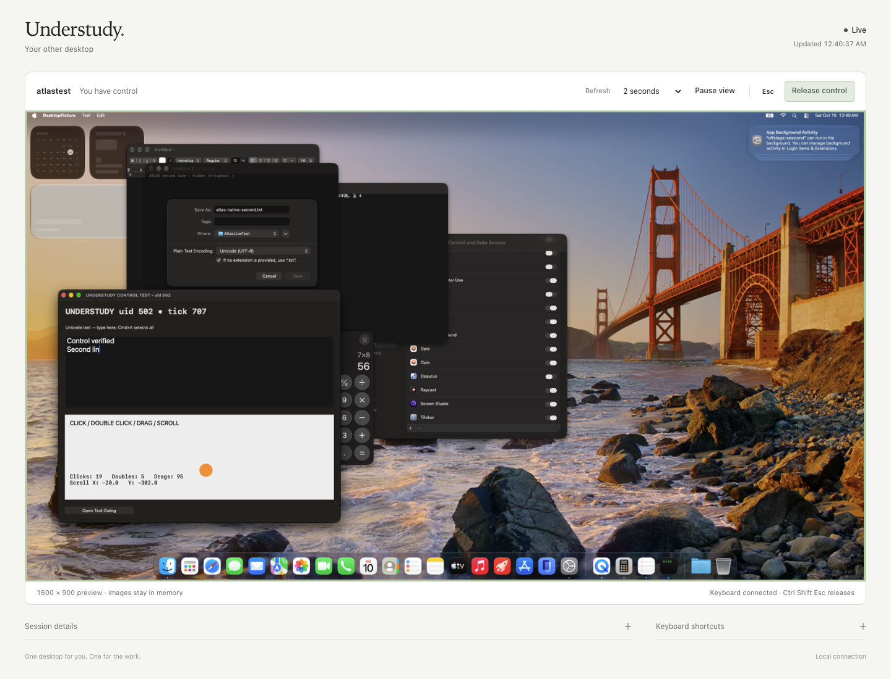
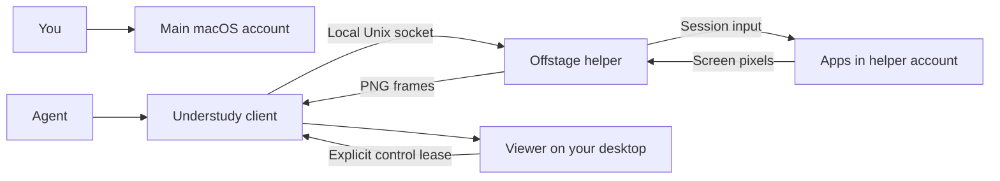

# Understudy

A separate macOS desktop for an agent, while you keep using yours.

Understudy connects to a native helper in a second, logged-in macOS account. It
captures that account's screen and sends input into its graphical session. The
human stays in the main account. A local viewer lets you watch the agent and
take mouse/keyboard control without switching users.

**Status: working, measured prototype.** A real 30-minute trial verified 360
cycles and 61 screenshots while the human worked normally. Audio leaked, native
Save dialogs stalled, window dragging missed its endpoint, and independent
controllers interleaved input. These limits remain open. See the
[measured results](docs/live-results.md).



## How it works



1. Fast User Switching leaves the second account logged in with its own app
   windows and graphical session.
2. A LaunchAgent keeps `offstage-sessiond` running in that account's Aqua session.
3. Understudy sends JSON requests over a local Unix socket. The native helper
   captures pixels and posts CoreGraphics events through `.cgSessionEventTap`.
4. Before an action, the client checks the configured UID, Aqua context, display
   and off-console state. The daemon also refuses input on-console. Long-action
   cancellation is still a measured limitation; these checks are not atomic.

This shares the host OS and hardware. It is not a VM or a machine sandbox. The
agent uses the helper account's apps and logins, not your personal windows.

## Use the prepared session

Python 3.9+ is sufficient for the client and viewer; no runtime packages are needed.

```sh
git clone --recurse-submodules https://github.com/InsaneArts/understudy.git
cd understudy
cp understudy.example.json understudy.local.json
# Set the helper UID and installed socket in that local configuration.
./understudy doctor
./understudy capture
./understudy monitor
```

On the original test Mac, local configuration is already prepared and the
existing consented helper is running. **Do not reinstall or move that binary.**
The example socket points to the trial's UID 502; another machine needs its own
prepared account and configuration. The client deliberately refuses UIDs below
502 and its own UID.

`monitor` prints a local URL and waits. Open the URL in your main browser. The
viewer refreshes every two seconds by default. Click **Take control**, then click
the desktop to connect the keyboard. Click, double-click, right-click, hover,
scroll, completed drags, Unicode text and shortcuts go to the hidden account.
The shortcut menu handles keys a browser may intercept. Browser/OS-reserved
shortcuts and continuously held keys cannot be fully forwarded.

**Release control** or **Ctrl–Shift–Esc** returns to observation. Pausing, hiding
the tab or leaving the browser releases control and clears queued input. Pause
affects this viewer; work already running on the helper can continue. An accepted
native action may finish after release. Other Understudy input, launch and restart
commands are refused while a viewer owns control; raw socket clients can bypass
this cooperative lock.

The server binds to loopback, uses an unguessable local URL and holds preview
frames in memory. It has no web command-launch endpoint. Closing the page stops
polling; Ctrl+C stops the server. The command opens no browser automatically.

Other commands:

```sh
./understudy status
./understudy apps
./understudy run -- /usr/bin/open -a Calculator
./understudy input '[{"type":"key","key":"escape"},{"type":"type","text":"123"}]'
./understudy input @actions.json
./understudy capture --max-dimension 1600
```

`run` executes argv in the helper account. Input affects its current frontmost
app. `capture` saves a PNG and returns its path. Actions use full display points;
when observing a downscaled image, convert using image and display dimensions.
Input is limited to short validated batches; long text should be sent in smaller
chunks with observation between them. If delivery becomes unknown, further
control is blocked. Observe the result and use `restart` to recover; it waits for
a new hidden helper PID. Never automatically replay an interrupted action.

Configuration can be selected with `--config path` or `UNDERSTUDY_CONFIG`.
Explicit screenshots, rotated payload-free metadata and private monitor
connection details go in ignored `runs/`.

## Make setup less painful

**Reuse one prepared helper account across tasks.** It does not need to be
created for every run. Its permissions and LaunchAgent persist. `doctor` reports
only the missing readiness steps, and the viewer removes the need to switch
accounts just to inspect progress.

The current prototype does not contain a general account-creation installer.
Initial account/login setup and normal privacy consent still require human
interaction. After logout/reboot, the helper graphical session needs to be
established again; unattended recovery from those states was not tested.
[Setup boundaries and the proposed installer](docs/setup.md) explain what can
be automated and what remains manual.

## Code map

| Path | Purpose |
| --- | --- |
| [`src/understudy/client.py`](src/understudy/client.py) | Guarded screenshots, input and helper commands |
| [`src/understudy/cli.py`](src/understudy/cli.py) | `understudy` commands and local configuration |
| [`src/understudy/session.py`](src/understudy/session.py) | Session identity and readiness diagnosis |
| [`src/understudy/control.py`](src/understudy/control.py) | Cooperative ownership, leases and interrupted delivery |
| [`src/understudy/monitor.py`](src/understudy/monitor.py) | Local viewer HTTP boundary |
| [`src/understudy/web/`](src/understudy/web/) | Minimal viewer UI, preview loop and browser input |
| [`offstage/native/sessiond/`](offstage/native/sessiond/) | Pinned upstream Swift capture/input daemon |
| [`live/`](live/) | Preserved, machine-specific native fixture and investigation harness |
| [`tests/`](tests/) | Client refusal checks, separate from live desktop evidence |
| [`docs/live-results.md`](docs/live-results.md) | Outcomes, measurements, screenshots and unresolved limits |

See [architecture and audit fixes](docs/architecture.md) for module contracts,
input limits and ownership semantics.

`live/` preserves the original experiment, including its fixed account paths and
PIDs. It is not a portable installer. Do not blindly rerun it: some scripts
perform real input, interrupt a daemon, or expect coordinated user switching.
The raw ~0.5 GB investigation archive remains local in ignored `evidence/`;
selected synthetic test images and measurements are included in `docs/evidence/`.

## Verification

```sh
python3 -m unittest discover -s tests -v
node --test tests/test_browser.mjs
```

The unit checks verify refusals; they are not desktop qualification. The new
client was also exercised against the real hidden session after relocation:
launching Calculator, observing its pixels, clicking 7×8 and capturing 56.
The viewer was checked against real helper frames and actual native input. The
browser checks need the pinned dependency's development packages:

```sh
cd offstage && npm ci && cd ..
./understudy monitor
# In another terminal, with Chrome installed:
node scripts/check-monitor.mjs
```

Both browser checks accept a monitor connection-file path as their first argument
for a custom output directory. The full control check opens a real browser window
without focus emulation and needs a prepared disposable AppKit fixture; see
[the live test instructions](tests/live/README.md).

To verify packaging, build in an isolated environment with current build tooling:

```sh
python3 -m venv .venv
.venv/bin/python -m pip install --upgrade pip
.venv/bin/python -m pip wheel . --no-deps
```

## Attribution

The native helper is Viraat Das's **Offstage 0.3.15**, pinned to
`38a2372b27add177b6768693270af78e4d07cefe`, included as an unchanged Git submodule.
It is MIT licensed. Understudy adds the client, observer and qualification
harness. See [NOTICE.md](NOTICE.md) and the [upstream license](offstage/LICENSE).
