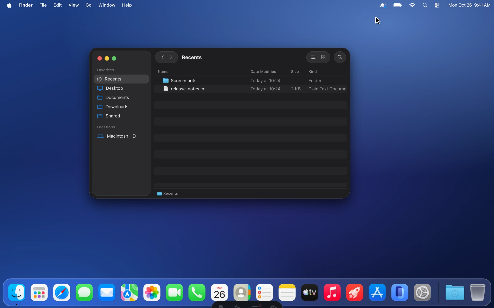

<p align="center">
  <picture>
    <source srcset="assets/logo-dark.svg" media="(prefers-color-scheme: dark)">
    <source srcset="assets/logo-light.svg" media="(prefers-color-scheme: light)">
    
  </picture>
</p>
<h3 align="center">hypervised desktop for autonomous agents</h3>
<p align="center">Atlas gives your agent a hidden second desktop on your Mac.<br>It clicks, types and tests apps there while you keep working on yours.</p>
<p align="center">
  <a href="https://github.com/InsaneArts/atlas/actions/workflows/ci.yml"></a>
  <a href="https://github.com/InsaneArts/atlas/releases"></a>
  
  <a href="Cargo.toml"></a>
</p>

[](https://atlas.insanearts.io)

## Install

Requires macOS 14 or later and an administrator account for setup. Public downloads will be available when Atlas is open source:

```sh
curl -fsSL https://atlas.insanearts.io/install.sh | sh
```

Atlas guides you through choosing a helper account and granting its macOS permissions. Leave the helper signed in, switch back to your account, and keep working. Watch from the menu bar or open the full viewer to take control.

See [Getting started](docs/getting-started.md) for setup and [Daily use](docs/using-atlas.md) for the workflow and practical limits.

## Connect your agent

Works with Claude Code, Claude Desktop, Codex, opencode and Pi. Connect installed hosts during setup, in **Settings > Agents**, or with:

```sh
atlas agents install
```

See [Agent connections](docs/agents.md) for configuration and project instructions.

## Watch and control

Watch the helper from Atlas's menu bar panel, the full Atlas viewer, or an embedded view inside the Claude and Codex apps. Expand the in-app view to use **Take Control** with your own mouse and keyboard. Choose **Give Back** or press **Control-Shift-Esc** when done; **Stop** cancels agent input and blocks further actions until you resume it.

See [Daily use](docs/using-atlas.md) and [Agent connections](docs/agents.md) for viewing options and host support.

## Contributing

[Contributing](CONTRIBUTING.md) covers builds, checks and pull requests. The [architecture guide](docs/architecture.md) maps the code and its responsibilities. Everyone taking part follows the [Code of Conduct](CODE_OF_CONDUCT.md). Report security issues privately through the [security policy](SECURITY.md).
