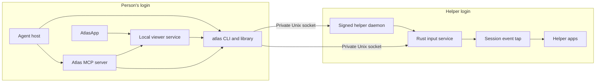

# Architecture

Atlas has a Rust library and CLI, a Swift app for the person using the Mac, and helper processes in a separate macOS login. This guide shows where behavior belongs and which boundaries a change must preserve. Build commands and required checks live in [Contributing](../CONTRIBUTING.md).

## Processes and communication

The agent and native viewer run in the person's login. The helper daemon runs as a managed LaunchAgent in the helper login. It holds the helper's macOS consent and starts a separate Rust input process.

The CLI and library box represents shared controller logic, not one permanent process through which every request passes. CLI invocations, the local viewer service and the MCP server use that logic in their own processes. AtlasApp talks to the viewer over a capability URL bound to the loopback interface and runs CLI commands for operations outside that service.

The helper daemon provides session facts, capture, accessibility inspection, running-app information and command execution. Input travels through its own socket and process, then goes only to the helper's session event tap. There is no global HID fallback.

The Unix transport checks the kernel-reported peer UID. The helper servers also check their caller. Socket access alone is not authorization to act: the client and helper validate the selected account, graphical session, hidden state and current display identity. The helper is still an ordinary macOS account sharing the same hardware and network, not a VM or security sandbox.

## Rust responsibilities

The Rust code is a workspace under [`crates/`](../crates), one package per layer, each depending only on the layers before it, so the compiler keeps them apart. [crates/AGENTS.md](../crates/AGENTS.md) lists the layers.

The binary keeps argument parsing, presentation and dispatch separate so library behavior does not depend on terminal formatting.

| Area                                                                                     | Responsibility                                                                                                                                                      |
| ---------------------------------------------------------------------------------------- | ------------------------------------------------------------------------------------------------------------------------------------------------------------------- |
| `crates/cli/src/bin/atlas/` `cli.rs`, `help.rs`, `policy.rs`, `output.rs`, `dispatch.rs` | CLI grammar, grouped help, command policy, output/exit behavior and routing into library operations.                                                                |
| `client`, `transport`, `session`                                                         | Helper requests, bounded transport and validation of account/session/display evidence.                                                                              |
| `control`                                                                                | Controller exclusion, viewer leases and persistent unknown-action records.                                                                                          |
| `host_session`                                                                           | Which agent session a command comes from, its records, and naming sessions in replies.                                                                              |
| `task`, `cleanup`, `collect`                                                             | Durable task claims, resumable cleanup receipts and verified copies collected from the helper.                                                                      |
| `daemon`                                                                                 | The signed helper daemon, protocol, session facts and bounded child-command execution.                                                                              |
| `native`                                                                                 | macOS capture, accessibility and input bindings, event execution, cancellation and held-input recovery.                                                             |
| `screen`                                                                                 | Portable observed geometry, windows, elements and selection, without native effects.                                                                                |
| `agent`, `handoff`, `readiness`                                                          | User-facing app operations, staged app copies and dependency checks.                                                                                                |
| `viewer`, `menubar`, `overview`                                                          | Local viewing/control service, native app launch and shared status/activity views.                                                                                  |
| `mcp`, `agents`, `claude_app`                                                            | Embedded host views and installation of supported agent connections.                                                                                                |
| `environment`                                                                            | Explicit file snapshots, environment profiles and resumable apply/rollback transactions.                                                                            |
| `user` (one per target; `crates/cli/src/bin/atlas/user/`)                                | The user desktop: its setup (`user::onboarding`, `user::setup`, `user/init.rs`), account identity, managed helper installation or repair, and its other operations. |
| `onboarding`, `setup`                                                                    | The person's own preferences, and the setup executor every desktop shares.                                                                                          |
| `update`, `uninstall`                                                                    | Verified app replacement, helper handover and ordered removal.                                                                                                      |

Names without a path in this table are crates or modules, each in the crate of its layer. Prefer the owner of the behavior over another layer that happens to call it. For example, an input cancellation rule belongs in control/native code; a button label belongs in the app's presentation code.

The [Rust contributor instructions](../crates/AGENTS.md) describe extension paths and the compiler-enforced decisions for commands, input actions, requests, tools, settings and records. A new operation follows its existing owner and exhaustive policy matches; it does not need a new service layer. Observation models, wire replies and durable recovery records have different compatibility and privacy obligations.

## Ownership, cancellation and uncertain results

Only one controller may act on a helper at a time. Reads take no lock and record nothing pending, including the fixed probes of environment discovery and environment previews. A file lock in the person's account provides exclusion across CLI, viewer and MCP processes, and each mutation holds it until its outcome is known, with one exception: a command started with `run` holds it only until its request reaches the helper. While the command runs, its claim keeps recovery, restart, log-out, update and setup out, and other controllers may act beside it. If its outcome becomes unknown, it blocks every controller like any other unknown outcome. A command-line controller that finds the lock held tries again for up to 30 seconds (for an agent's command, unless `--wait` says otherwise) before answering busy; it never waits while the person holds control or has stopped agents, and the viewer never waits. A person taking control holds a renewable lease. Ending or losing that lease must release control and any held input before another controller acts.

The native input service separates its ownership gate from the serialized event engine. Cancellation can revoke ownership while a gesture is waiting; it does not wait behind that gesture's execution lock. Cleanup still retains exclusion so a new controller cannot act while held keys or buttons are being released.

An agent's request may name its app; the input service then refuses each action, before its first event and under the engine lock, unless that app has keyboard focus (text and keys) or has an uncovered window at the point (pointer actions). An input service that cannot check is refused before anything is sent, and a checked reply must echo what it checked.

Requests are tied to a display epoch: the account, graphical session, display and input/capture processes observed for the action. A fresh screenshot alone cannot authorize input into a different epoch. Frame and epoch checks must remain connected through the full request.

Before a mutation, Atlas records that its outcome is pending. A complete acknowledgement settles that record. A disconnected caller, timeout or dead executor is not an acknowledgement. Each mutation is sent under a name of its own, and the helper's daemon and input service each remember, in memory, what the most recent named ones came to. When a reply never arrives, the controller asks the service that took the request; only a remembered final reply, checked as the lost one would have been, settles the record. A service that restarted remembers nothing, a repeated change is refused while the service remembers it, and a command started with `run` is never asked about, because its reply is its output. A command stopped by a signal starts nothing more, lets the step under way finish for a short grace, and settles only what was acknowledged; a step still under way then stays pending. Unknown outcomes remain pending until supported recovery confirms the required new helper state. Recovery never replays the action. A running command's record is marked as one, so other controllers can tell work under way from an outcome nothing will settle.

Each agent command records the host session it comes from (a Claude Code session, a Codex thread, an opencode or Pi session), read from its host's environment: on its activity row, its screenshot's row, its handoff copies, a session record in the output folder, a note beside the controller lock and a list of which session claimed each pending change. A host session is a label for people and agents. It never decides input, control, Stop, recovery, rollback or what may be deleted; it only narrows which handoff copies `close` removes.
Host detection reads the agent's process ancestry, and when it cannot verify the host itself it asks the helper daemon, which checks the caller through its socket's kernel peer. An identity Atlas cannot verify stays unknown; neither a claimed process ID nor an unreadable process proves identity or death.

Session reads sample host liveness through one shared, bounded sampler. A running or stopped host stays live, an explicit end always stays ended, and an unknown state proves neither. Session presentation never decides control, recovery or what may be deleted, and doctor stays not ready while an outcome is unresolved or pending state cannot be read.

A background job an agent starts is a change only until it runs: once the helper daemon has verified its identity it runs outside controller exclusion, beside other controllers' actions, until it ends, is stopped, reaches its time limit, the person stops agents or the helper comes on screen. Only the job's own process group is ever signalled, and only after a fresh look shows its leader is still the process Atlas started. A job whose leader is gone, or whose record cannot be read, is never signalled.

Collecting a file reads in the helper and changes nothing there; the copy is kept only once its SHA-256 matches. Cleanup checks those copies first, and never removes the file a missing or changed copy came from.

Cleanup takes a thing away only after checking that thing itself, holds control from start to end, writes a receipt before each step and resumes from it after a crash. It moves an install into a private holding folder of the helper's install store (`~/.config/atlas/installs/held/<installId>/`) rather than deleting it, so a wrong judgement can be undone for 7 days. A record Atlas cannot read is kept and never acted on, and finishing an effect is separate from acknowledging its records, so bookkeeping is retried without repeating an effect.

The input journal records held keys and mouse buttons separately. A replacement input service cleans up held input before accepting new work. Tests for cancellation or recovery must include failure during execution and cleanup, not just a successful command followed by release.

## Native and embedded views

The local viewer service supplies pictures, status, activity, sessions, screenshots and control to AtlasApp. Beside it, the menu bar runs the [frame pipe](frame-pipe.md): one demand-driven source of raw pictures that AtlasApp and the terminal viewer share over private Unix sockets, falling back to the viewer's PNG pictures when it is unavailable. Frames have identities and freshness limits; user input is checked against the frame and control lease it came from. Status polling is not proof that a fresh picture has arrived.

The person's app alone receives `consoleName` in the status: `{"state":"this"}`, `{"state":"another","name":"atlas"}` or `{"state":"unknown"}`. Atlas reads it again at most every 15 seconds; when a reading is late, the last one is used while it is under 30 seconds old, and unknown after that. Other viewer callers receive no `consoleName` field.

The MCP server offers status, `show_screen` and `take_screenshot` to agent hosts. `take_screenshot` runs `atlas screenshot`, so its guards and record are the command's, and returns the image with its reply. It runs as no session's: one server can serve several chats, and a session's screenshot sets where its untargeted input goes. A host that supports embedded UI can render the bundled view in `crates/cli/src/mcp/screen.js`. The view's own polling and controls are separate from model-facing tools. Host capability and tool visibility checks preserve that distinction, including the rule that only the person resumes stopped agents.

The native window and an embedded card can fail independently. Keep host rendering or routing issues separate from capture permission and helper readiness. [Agent connections](agents.md) describes the routes visible to users.

## Swift package boundaries

The package graph is defined in [`app/Package.swift`](../app/Package.swift) and each local package's manifest. All use Swift 6 language mode. AtlasApp owns AppKit shells, with one controller and presenter per window. Controllers perform work; presenters turn domain results into UI state and words; views draw that state and send events.

| Package         | Owns                                                                      | Shipping dependencies within Atlas |
| --------------- | ------------------------------------------------------------------------- | ---------------------------------- |
| AtlasService    | Viewer-service models, client interface and live client.                  | None.                              |
| AtlasCommands   | CLI execution and replies, agent status, login item and login records.    | AtlasService.                      |
| AtlasControl    | Mouse, keyboard and text mapping, and the input queue.                    | AtlasService.                      |
| AtlasStatus     | Shared interpretation of readiness, freshness and recovery state.         | AtlasService.                      |
| AtlasOnboarding | Setup step selection, account/password rules and permission requirements. | AtlasCommands.                     |
| AtlasUI         | Design tokens, components, window states/events, views and previews.      | None.                              |
| AtlasApp        | AppKit windows, controllers, presenters, launch and app composition.      | All six packages above.            |

AtlasUI imports no domain package, and domain packages do not import AtlasUI. `AsyncSupportTesting` and the domain packages' testing products support tests only. Shipping targets do not depend on those products. Preserve these directions when moving a type or introducing a dependency.

## Setup, storage and lifecycle

Setup records the helper's account identity, including the identity macOS does not reuse when a UID is reassigned. Managed service changes record their progress and verify the new service before retiring the previous one. Update verifies a complete signed app and records the handover before replacement. Uninstall holds exclusion while logging out, retiring owned services and removing installation data; helper account deletion is an explicit separate choice.

These operations cannot be implemented as a collection of unconditional file deletions or command retries. An interrupted operation needs its records to decide what remains, and cleanup must not erase the evidence needed by another process.

[Configuration](configuration.md#where-data-lives) owns the storage map. In brief, the person's account holds settings, captures, service records and control state; the helper holds its sockets, logs, selected environment and transaction records. Swift UI preferences live in user defaults. Each has a different cleanup owner, as described in [Maintenance](maintenance.md).

## Checks and desktop evidence

Rust tests cover protocol, ownership, recovery and file transactions. CLI contract tests check real process output and exit behavior. Node tests cover the embedded view, host integrations and repository checks. Swift tests exercise service models, rules, presentation and interaction state with controlled dependencies.

Those checks do not prove that macOS accepted input or displayed a native dialog. A DOM fixture, rendered preview or simulated Swift state is useful for its own layer, but it is not native desktop evidence. For changed input, capture, window or setup behavior, exercise the actual helper and record what happened. Native Save/Open checks use the AppKit fixture and remain distinct from custom test views.

Run the checks listed in [Contributing](../CONTRIBUTING.md#check-your-change). Coordinate physical locking, sleep and account switching with the person using the Mac. Keep investigation evidence private and publish only the concise result needed to review the change.
