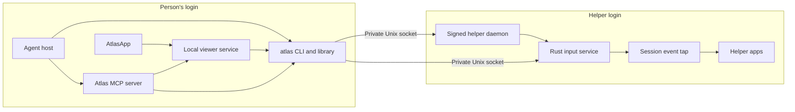

# Architecture

Atlas has a Rust library and CLI, a Swift app for the person using the Mac, and helper processes in a separate macOS login. This guide shows where behavior belongs and which boundaries a change must preserve. Build commands and required checks live in [Contributing](../CONTRIBUTING.md).

## Processes and communication

The agent and native viewer run in the person's login. The helper daemon runs as a managed LaunchAgent in the helper login. It holds the helper's macOS consent and starts a separate Rust input process.

The CLI and library box represents shared controller logic, not one permanent process through which every request passes. CLI invocations, the local viewer service and the MCP server use that logic in their own processes. AtlasApp talks to the viewer over a capability URL bound to the loopback interface and runs CLI commands for operations outside that service.

The helper daemon provides session facts, capture, accessibility inspection, running-app information and command execution. Input travels through its own socket and process, then goes only to the helper's session event tap. There is no global HID fallback.

The Unix transport checks the kernel-reported peer UID. The helper servers also check their caller. Socket access alone is not authorization to act: the client and helper validate the selected account, graphical session, hidden state and current display identity. The helper is still an ordinary macOS account sharing the same hardware and network, not a VM or security sandbox.

## Rust responsibilities

The library entry point is [`src/lib/lib.rs`](../src/lib/lib.rs). The binary keeps argument parsing, presentation and dispatch separate so library behavior does not depend on terminal formatting.

| Area                                                    | Responsibility                                                                                          |
| ------------------------------------------------------- | ------------------------------------------------------------------------------------------------------- |
| `src/bin/cli.rs`, `help.rs`, `output.rs`, `dispatch.rs` | CLI grammar, grouped help, output/exit behavior and routing into library operations.                    |
| `client`, `transport`, `session`                        | Helper requests, bounded transport and validation of account/session/display evidence.                  |
| `control`                                               | Controller exclusion, viewer leases and persistent unknown-action records.                              |
| `daemon`                                                | The signed helper daemon, protocol, session facts and bounded child-command execution.                  |
| `native`                                                | macOS capture, accessibility and input bindings, event execution, cancellation and held-input recovery. |
| `agent`, `handoff`, `readiness`                         | User-facing app operations, staged app copies and dependency checks.                                    |
| `viewer`, `menubar`, `overview`                         | Local viewing/control service, native app launch and shared status/activity views.                      |
| `mcp`, `agents`, `claude_app`                           | Embedded host views and installation of supported agent connections.                                    |
| `environment`                                           | Explicit file snapshots, environment profiles and resumable apply/rollback transactions.                |
| `init`, `onboarding`, `setup`                           | Guided setup, setup facts, account identity and managed helper installation or repair.                  |
| `update`, `uninstall`                                   | Verified app replacement, helper handover and ordered removal.                                          |

Paths without a directory prefix in this table are under `src/lib`. Prefer the owner of the behavior over another layer that happens to call it. For example, an input cancellation rule belongs in control/native code; a button label belongs in the app's presentation code.

## Ownership, cancellation and uncertain results

Only one controller may mutate a helper at a time. A file lock in the person's account provides exclusion across CLI, viewer and MCP processes. A command-line controller that finds the lock held tries again for up to 30 seconds (for an agent's command, unless `--wait` says otherwise) before answering busy; it never waits while the person holds control or has stopped agents, and the viewer never waits. A person taking control holds a renewable lease. Ending or losing that lease must release control and any held input before another controller acts.

The native input service separates its ownership gate from the serialized event engine. Cancellation can revoke ownership while a gesture is waiting; it does not wait behind that gesture's execution lock. Cleanup still retains exclusion so a new controller cannot act while held keys or buttons are being released.

Requests are tied to a display epoch: the account, graphical session, display and input/capture processes observed for the action. A fresh screenshot alone cannot authorize input into a different epoch. Frame and epoch checks must remain connected through the full request.

Before a mutation, Atlas records that its outcome is pending. A complete acknowledgement settles that record. A disconnected caller, timeout or dead executor is not an acknowledgement. Unknown outcomes remain pending until supported recovery confirms the required new helper state. Recovery never replays the action.

The input journal records held keys and mouse buttons separately. A replacement input service cleans up held input before accepting new work. Tests for cancellation or recovery must include failure during execution and cleanup, not just a successful command followed by release.

## Native and embedded views

The local viewer service supplies pictures, status, activity, apps, screenshots and control to AtlasApp. Frames have identities and freshness limits; user input is checked against the frame and control lease it came from. Status polling is not proof that a fresh picture has arrived.

The MCP server offers status and `show_screen` to agent hosts. A host that supports embedded UI can render the bundled view in `src/lib/mcp/screen.js`. The view's own polling and controls are separate from model-facing tools. Host capability and tool visibility checks preserve that distinction, including the rule that only the person resumes stopped agents.

The native window and an embedded card can fail independently. Keep host rendering or routing issues separate from capture permission and helper readiness. [Agent connections](agents.md) describes the routes visible to users.

## Swift package boundaries

The package graph is defined in [`app/Package.swift`](../app/Package.swift) and each local package's manifest. All use Swift 6 language mode. AtlasApp owns AppKit shells, with one controller and presenter per window. Controllers perform work; presenters turn domain results into UI state and words; views draw that state and send events.

| Package         | Owns                                                                      | Shipping dependencies within Atlas |
| --------------- | ------------------------------------------------------------------------- | ---------------------------------- |
| AtlasService    | Viewer-service models, client interface and live client.                  | None.                              |
| AtlasCommands   | CLI execution and replies, agent status, login item and login records.    | AtlasService.                      |
| AtlasControl    | Mouse, keyboard and text mapping, and the input queue.                    | AtlasService.                      |
| AtlasStatus     | Shared interpretation of readiness, freshness and recovery state.         | AtlasService.                      |
| AtlasOnboarding | Setup step selection, account/password rules and permission requirements. | AtlasCommands.                     |
| AtlasUI         | Design tokens, components, window states/events, views and previews.      | None.                              |
| AtlasApp        | AppKit windows, controllers, presenters, launch and app composition.      | All six packages above.            |

AtlasUI imports no domain package, and domain packages do not import AtlasUI. `AsyncSupportTesting` and the domain packages' testing products support tests only. Shipping targets do not depend on those products. Preserve these directions when moving a type or introducing a dependency.

## Setup, storage and lifecycle

Setup records the helper's account identity, including the identity macOS does not reuse when a UID is reassigned. Managed service changes record their progress and verify the new service before retiring the previous one. Update verifies a complete signed app and records the handover before replacement. Uninstall holds exclusion while logging out, retiring owned services and removing installation data; helper account deletion is an explicit separate choice.

These operations cannot be implemented as a collection of unconditional file deletions or command retries. An interrupted operation needs its records to decide what remains, and cleanup must not erase the evidence needed by another process.

[Configuration](configuration.md#where-data-lives) owns the storage map. In brief, the person's account holds settings, captures, service records and control state; the helper holds its sockets, logs, selected environment and transaction records. Swift UI preferences live in user defaults. Each has a different cleanup owner, as described in [Maintenance](maintenance.md).

## Checks and desktop evidence

Rust tests cover protocol, ownership, recovery and file transactions. CLI contract tests check real process output and exit behavior. Node tests cover the embedded view, host integrations and repository checks. Swift tests exercise service models, rules, presentation and interaction state with controlled dependencies.

Those checks do not prove that macOS accepted input or displayed a native dialog. A DOM fixture, rendered preview or simulated Swift state is useful for its own layer, but it is not native desktop evidence. For changed input, capture, window or setup behavior, exercise the actual helper and record what happened. Native Save/Open checks use the AppKit fixture and remain distinct from custom test views.

Run the checks listed in [Contributing](../CONTRIBUTING.md#check-your-change). Coordinate physical locking, sleep and account switching with the person using the Mac. Keep investigation evidence private and publish only the concise result needed to review the change.
