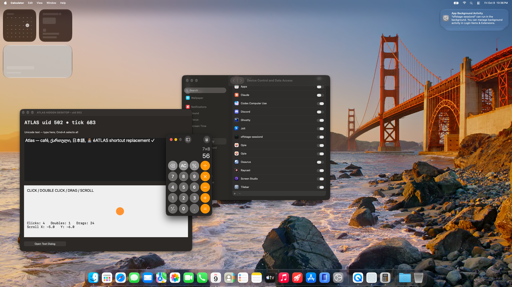
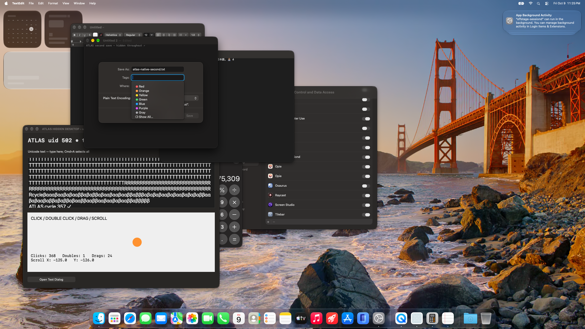

# Measured desktop results — October 9, 2026

**Proceed as a restricted prototype, not arbitrary unattended macOS automation.**
These results came from a real logged-in background account on an Apple M5 Pro
(18 cores, 64 GiB), macOS 27.0.1 build 26A434. The helper was UID 502 in Aqua,
2560×1440 at scale 1. SIP and FileVault stayed enabled. Normal privacy consent was
completed by the user. Offstage's pinned native source and installed binary were
unchanged throughout the measured trial.

## Sustained run

- Duration: **1800.005 seconds**, 18:43:26–19:13:26 UTC.
- **360 verified cycles**, 540 input RPCs, 61 full PNG captures; zero verification failures.
- 360 target clicks, 120 text marker insertions, 60 paired scroll cycles.
- Full capture: **219.4 ms median / 240.1 ms p95**, 61 samples.
- Click until native fixture state confirmed it: **11.5 ms median / 40.6 ms p95**,
  360 samples. This is state-observation latency, not display scanout latency.
- Human reported normal work without visual/input interference.
- 16,975 host samples detected no tested helper app becoming frontmost. The
  window monitor covered only the latter 923 seconds; 8,730 samples had no helper
  window matches. No personal keys, clipboard contents or host screen images were logged.

Text checks verified each new marker arrived; they did not establish correct
end-of-document navigation or preservation of every earlier marker. The minimal
fixture lacks a normal Edit menu; its Cmd+A failed. TextEdit Cmd+A did work.

## Working behavior and actual failures

| Area | Observed result |
| --- | --- |
| Pixels, mouse, text | Fresh hidden pixels, native click/double-click, exact multilingual Unicode; Calculator 7×8=56 and 8675309 keyboard entry |
| Menus and dialog | Native fixture menu counter and alert response verified |
| Scrolling | Worked with pointer settling; two initial unpaced vertical requests failed |
| Dragging | Fixture endpoint correct; TextEdit title-bar movement missed the requested delta |
| Native saving | TextEdit Save stayed disabled; after coordinated transitions it enabled and saved one exact file. A fresh document created while hidden reproduced the disabled Save panel and no file |
| Clipboard | One helper→host sentinel probe passed; reverse direction untested |
| File permissions | Host 0600 sentinel denied; 0644 readable, not writable; actual write refused |
| Audio | **Failed isolation:** human heard the helper's tone after unmuting their output |
| Notifications | Inconclusive: command acknowledged, source delivery unconfirmed |
| Exclusive control | **Failed:** two clients' 50 α and 50 β characters interleaved with 68 alternations |
| Interrupted action | Restart left 88 of 5,000 characters and no final response; new daemon ready at 438.35 ms after restart request, then click/capture worked |
| Lock and sleep | One lock/unlock and one actual sleep/wake recovered with external watchdog; power log recorded six seconds asleep before dark/full wake |
| Switching during typing | Watchdog stopped a 40,046-character action after 9,384 characters. Two callbacks occurred after detection (last ~12.4 ms later), zero while helper was on-console. On-console empty input refused; post-return click/capture worked |

The watchdog is experimental harness code, not an atomic cancellation guarantee
in the stock daemon. It relies partly on the undocumented `IOConsoleLocked`
registry key. The sleep observer expired while the user was away; a separately
guarded follow-up verified the post-wake desktop. The sleep-notification branch
was not independently exercised because the watch had already triggered on lock.

Retina 2×, several displays/accounts, logout/reboot recovery and VM desktops remain
untested. A positive virtualization preflight is not a guest-desktop result.
Account-wide summed RSS double-counted shared pages, so it is not an incremental
memory cost measurement.

## Retained visual evidence

The agent chose native Calculator button coordinates from its real screenshot:

A fresh native Save dialog reproduced the disabled button:

The new project client was then verified against the same prepared session after
relocation. Its viewer uses real helper frames, refreshed in memory. The unit
guard tests and headless browser UI checks are kept distinct from the original
30-minute desktop trial. [Measurement packet and provenance](evidence/measurements.json).

Raw RPCs, screenshots, fixture events and all original measurements remain in
the local, Git-ignored `evidence/` archive. The Desktop compatibility symlink
preserves the original report's links. The selected packet includes hashes of
its original source artifacts; no unrun test is presented as a pass.
